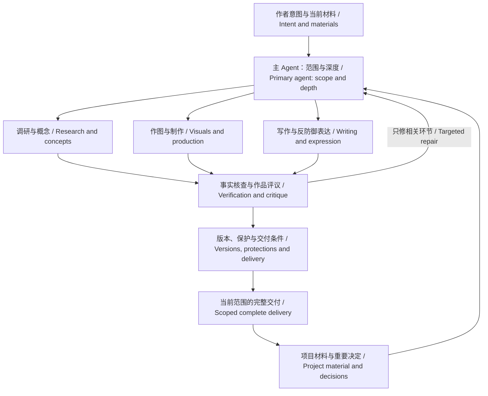

# ACHE 艺术设计 Agent 框架 v3.0
# ACHE Art & Design Agent Framework v3.0

版本：3.0.0；更新日期：2026-11-24。
Version: 3.0.0; updated: 24 November 2026.

本版执行已制定的优化计划，保留一个主 Agent 按需调用八个模块的结构，并保留你的中英文反防御性写作原件与参考副本。
This version implements the approved optimization plan, retains one primary agent with eight on-demand modules, and preserves your Chinese and English anti-defensive writing originals and snapshots.

## 本次变化 / Changes

| 部分 / Area | 当前行为 / Current behavior |
|---|---|
| 检查与版本 / Checks and versions | 实际检查关联任务、输入、输出和证据指纹；相关文件变化后旧通过项失效。 / Performed checks bind task, inputs, outputs and evidence fingerprints; relevant changes invalidate old passes. |
| 局部保护 / Local protection | 精确文字、段落范围、SVG 对象与图像顺序可锁定，另查授权区域外的变化。 / Lock exact text, text sections, SVG objects and image order, then compare changes outside the authorized scope. |
| 调研 / Research | 按问题比较材料的根据与差异，区分文稿自述、实证结果与设计提议。 / Compare evidence and differences by question, separating documentary accounts, empirical findings and proposals. |
| 分析图 / Analytical diagrams | 保留现有与拟议关系的区分，交付可编辑源文件，并打开实际导出图像检查。 / Distinguish recorded and proposed relationships, provide editable sources, and open actual exports for inspection. |
| 写作 / Writing | 分别检查事实、原意和表达力度，保留标题及必要条件，正文突出成立的贡献。 / Review facts, meaning and rhetorical force separately, preserve titles and material conditions, and foreground supported contributions. |
| 跨文件核查 / Cross-artifact review | 比较当前版本与具体位置，区分 PDF 页序和书内页码，检查相邻页后再判断遗漏。 / Compare current versions at concrete locations, distinguish PDF indices and printed pages, and check adjacent pages before reporting omissions. |
| 迁移 / Portability | 默认新项目清空旧结论和私有试用材料，保留已有用户指令，遇到文件冲突先停止。 / New-project restoration resets old conclusions and private pilots, preserves existing instructions and stops on conflicts. |
| 成本与深度 / Cost and depth | 快速、标准、深入三档按范围选择，只有可观测的时间、token 和金额才能记录为实测。 / Select quick, standard or deep coverage by scope and record only observable time, tokens and costs as measured. |

## 架构 / Architecture



模块是主 Agent 可调用的能力与方法，不默认对应八个独立模型，也不在环节之间机械要求审批。
The modules are capabilities and methods used by the primary agent, not eight default independent models, and they do not impose approval between stages.

艺术探索、应用设计、研究型设计与混合项目按实际方法选择评议标准，创作意图和重要取舍保留给作者。
Artistic, applied, research-led and mixed projects use criteria appropriate to their actual methods, with creative intent and consequential choices retained by the author.

## 保留反防御性写作 / Preserved anti-defensive writing

两个原始技能及两份参考副本保持原有字节和 MIT 许可，未改写、覆盖、卸载或重新安装。
The two original skills and their snapshots retain their bytes and MIT notice, without rewriting, replacement, removal or reinstallation.

正文直接表达材料支持的价值，不重复自我削弱或把核查日志写成作品正文；会改变结论的条件仍保留在适当位置。
Prose states the value supported by the material without repetitive self-undermining or verification logs, while conditions affecting the conclusion remain in appropriate locations.

## 验证范围 / Validation scope

本版完成八个有界流程试用，涵盖调研、作图、写作和跨文件核查，每类含正常任务与边界案例；另用相同夹具比较 v2 与 v3 的六类记录机制。
This version completes eight bounded workflow pilots across research, visuals, writing and cross-artifact review, with normal and boundary cases for each, plus six matched v2/v3 mechanism fixtures.

已知错误由同一主 Agent 植入并检查，不能据此声称盲测准确率、独立核验或整份论文已经验证。
The same primary agent seeded and checked known errors; these trials do not establish blinded accuracy, independent verification or validation of an entire thesis.

完整快照中的 `project/evaluation/report.md` 记录输入版本、实际产物、检视范围、机制比较与剩余限制；模板导出会排除私有项目材料。
In a full snapshot, `project/evaluation/report.md` records input versions, actual outputs, inspection scope, mechanism comparisons and limitations; template export excludes private project material.

本版直接支持的局部保护格式为 UTF-8 文本和稳定 ID 的 SVG；PDF、Word、InDesign 与 CAD 的任意原生对象锁定不在已实现范围内。
Implemented local protection covers UTF-8 text and SVG with stable IDs; arbitrary native object locking in PDF, Word, InDesign and CAD is outside this implementation.

## 使用与检查 / Use and checks

直接提出要完成的任务，或说“按 ACHE 框架调研／作图／写作／核查”，主 Agent 会选择必要工作流与执行深度。
State the task directly or ask to research, draw, write or verify with ACHE; the primary agent selects the necessary workflow and execution depth.

```bash
python3 agent-framework/scripts/check_framework.py
python3 agent-framework/scripts/task_guard.py status
python3 -m unittest discover -s agent-framework/tests -v
python3 agent-framework/scripts/task_guard.py environment
```

这些命令检查配置、文件依赖和已声明记录，不证明资料真实性、艺术质量、建造可行性或现场测试结果。
These commands check configuration, file dependencies and declared records, not source truth, artistic quality, construction feasibility or field-test results.

## 迁移与分享 / Restore and share

恢复脚本使用下方配置中的 `agent-framework/scripts/restore_framework.py`，默认保留目标项目已有的 `AGENTS.md` 并追加框架入口，遇到框架文件冲突时不覆盖。
Use the bundled `agent-framework/scripts/restore_framework.py`; by default it preserves an existing target `AGENTS.md`, appends the framework entry and refuses conflicting framework files.

```bash
python3 agent-framework/scripts/restore_framework.py framework.md /path/to/new-project
python3 agent-framework/scripts/bundle_framework.py --mode template --output shareable-framework.md
```

第一条默认建立空项目记录，第二条生成适合分享的框架文件，不携带当前论文摘录、检查结论或私有试用材料。
The first command creates fresh project records by default; the second generates a shareable framework without current manuscript excerpts, check conclusions or private pilot material.

个人完整快照可用 `--mode snapshot` 保留，但原有检查仍需在实际目标环境重新核对。
Use `--mode snapshot` to retain a personal full snapshot, and recheck its records in the actual destination environment.

这是项目指令和执行记录框架，使用当前宿主提供的模型与工具；本次没有安装全局插件或启动后台服务。
This is a project instruction and execution-record framework using host models and tools; it does not install a global plugin or start a background service.

## 上游与许可 / Upstream and licensing

方法来源仍为固定版本的 [Supervisor-Skills](https://github.com/HKUSTDial/Supervisor-Skills)，其署名、具体文件与提交保存在 `upstream.lock.json` 和 `references/supervisor-adaptation.md`。
The methodology remains grounded in the pinned [Supervisor-Skills](https://github.com/HKUSTDial/Supervisor-Skills) revision, with attribution, file identities and commit recorded in `upstream.lock.json` and `references/supervisor-adaptation.md`.

改编方法保留 CC BY-NC-SA 4.0 许可，反防御性写作保持自己的 MIT 许可，使用和再分发时分别遵守。
Adapted methodology retains CC BY-NC-SA 4.0 terms, while anti-defensive writing retains its own MIT notice; observe the applicable terms when using or redistributing each.

## 完整配置 / Complete configuration

下方保存相对路径、文件编码、SHA-256 和完整内容；二进制产物以 base64 保留，恢复前必须校验摘要与路径。
The bundle below preserves relative paths, encodings, SHA-256 hashes and full content; binary artifacts use base64, with digests and paths checked before restoration.
